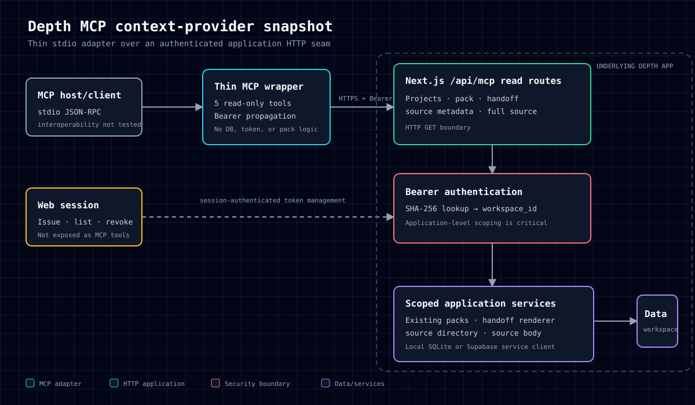

# Depth MCP Context Provider

> **Historical engineering snapshot, not a live-service claim.**
>
> This repository documents one implemented and tested state of Depth's read-only context-provider seam. The source snapshot is pinned to commit `364f3e02d8b944a0439e9be3ab191259b3385b9e` on branch `release/autonomous-reviewer-alpha`. The underlying project may later change, be superseded, or be discontinued. Nothing here asserts that Depth is currently deployed, production-ready, or actively maintained.

## What problem was this intended to solve?

AI coding tools often need project context that is scattered across application records and sources. The implementation exposed an authenticated, workspace-scoped path for an external MCP client to retrieve:

- the projects visible to one workspace;
- the latest source-linked context pack for a project;
- a generated handoff document for a supported agent target;
- a metadata-only source directory; and
- one explicitly requested source body.

The design separates low-disclosure discovery from deliberate content expansion: source search returns metadata, while full content requires a separate `get_source` call.

## What was actually implemented?

This snapshot contains two related layers:

1. **Thin MCP adapter** — a Node.js stdio server that exposes five tools, forwards bearer-authenticated HTTP GET requests to Depth, and returns the JSON responses as MCP text content.
2. **Underlying Depth application seam** — Next.js API routes and server-side data-access code that issue and hash tokens, authenticate bearer requests, enforce workspace boundaries, retrieve existing context packs, render handoffs, search source metadata, and return a selected source body.

The MCP adapter does **not** issue tokens, hash credentials, enforce workspace scoping, generate context packs, or construct handoffs itself. Those behaviors live in the underlying application code included here for inspection.

## Five read-only tools

| MCP tool | HTTP route | Purpose |
|---|---|---|
| `list_projects` | `GET /api/mcp/projects` | List non-archived projects in the token's workspace. |
| `get_context_pack` | `GET /api/mcp/projects/:id/pack` | Retrieve the latest existing context pack and source links. It does not generate a new pack. |
| `get_handoff` | `GET /api/mcp/projects/:id/handoff?target=...` | Ask the application to render a handoff for a supported target. |
| `search_sources` | `GET /api/mcp/projects/:id/sources?query=...` | Search title/body server-side but return source metadata only. |
| `get_source` | `GET /api/mcp/sources/:id` | Retrieve one explicitly selected source's full body and metadata. |

See [`docs/TOOL_CONTRACTS.md`](docs/TOOL_CONTRACTS.md) for the detailed contracts and limitations.

## Architecture



The primary security boundary is the application's HTTP API, not the MCP wrapper. The wrapper forwards `DEPTH_MCP_TOKEN` as an Authorization bearer token. The application hashes the supplied token, resolves it to a workspace, and applies workspace checks before returning data.

See:

- [`docs/ARCHITECTURE.md`](docs/ARCHITECTURE.md)
- [`SECURITY.md`](SECURITY.md)
- [`docs/TESTING_AND_EVIDENCE.md`](docs/TESTING_AND_EVIDENCE.md)

## Authentication and source provenance

At this snapshot:

- token creation used 24 random bytes with a `depth_mcp_` prefix;
- only the SHA-256 token hash was stored;
- plaintext was returned once at creation;
- token listing omitted plaintext and hashes;
- revocation deleted the workspace-scoped token row;
- bearer authentication resolved the hash to a `workspace_id`;
- project and source reads were checked against that workspace;
- context-pack claims returned supporting source IDs, titles, types, and freshness state;
- metadata search did not return source bodies;
- full body exposure required `get_source`.

In Supabase mode, the token is not a normal user session. A server-side service client performs the read and the application code supplies the workspace boundary. This makes consistent application-level scoping a security-critical responsibility.

## Test evidence

The preserved smoke-test source drives the real Next.js HTTP stack in isolated local SQLite mode. It does **not** instantiate an MCP client or exercise MCP protocol interoperability.

The recorded historical result was:

```text
PASS — 16 passed, 0 failed
```

The checks covered token issuance and non-reexposure, bearer rejection, project/context-pack/handoff/source reads, source linking, metadata-only discovery, explicit full-source retrieval, HTTP method rejection, selected secret-pattern non-disclosure, workspace isolation, revocation, and one Slack-unconfigured behavior.

A separate preparation-time run also completed with 16 passes and zero failures after a clean build and TypeScript check. It is recorded separately so that it does not rewrite the historical result.

See [`docs/TESTING_AND_EVIDENCE.md`](docs/TESTING_AND_EVIDENCE.md).

## Important reproducibility boundary

**This extracted portfolio repository is not a standalone runnable copy of Depth.**

The MCP wrapper depends on:

- the external `@modelcontextprotocol/sdk` package;
- a running Depth application exposing the documented HTTP routes; and
- a valid token issued by that application.

The smoke test depends on the full private Depth application, including its Next.js routes, local database implementation, context-pack generator, handoff renderer, auth/session code, and related domain types. Those dependencies are not recreated or mocked here. The included backend files are an inspectable architectural slice, not a buildable application.

## Limitations

- No separate MCP-client handshake, tool-discovery, or tool-call interoperability test was found or run.
- The SDK dependency was referenced by the adapter but was not pinned in the Depth application package manifest.
- The smoke suite tested the HTTP context API, not the stdio adapter end to end.
- Read-only behavior was supported by tool design and absent write handlers; this is not a formal capability proof.
- Workspace isolation was sampled on context-pack and full-source routes, not exhaustively across every route.
- The payload secret scan used a finite regular expression, not a comprehensive data-loss-prevention review.
- Token expiration, rate limiting, and broader abuse controls were not evidenced in the inspected slice.
- The repository does not establish current deployment, current maintenance, production readiness, or later project status.

## Snapshot provenance

| Event | Evidence |
|---|---|
| MCP implementation present in repository history | Commit `5a536a24621aab80755ad229a8f2508c084d6268`, dated 2026-07-12 |
| MCP README later updated | Commit `ed9dea07b2fd80c102adf9167aa12c88f90a23a0`, dated 2026-07-12 |
| Source snapshot extracted | Commit `364f3e02d8b944a0439e9be3ab191259b3385b9e`, dated 2026-07-17 |
| Historical smoke result | 2026-10-12, exact original timestamp not retained |
| Portfolio snapshot prepared | 2026-10-12 |

Full details: [`docs/PROVENANCE.md`](docs/PROVENANCE.md).

## Repository map

```text
mcp/                         Historical MCP documentation and stdio adapter
scripts/                     Historical HTTP smoke-test source
src/app/api/mcp/             Selected Next.js token and read-route handlers
src/lib/server/              Bearer authentication and scoped data access
supabase/migrations/         Token schema and workspace-member policy

docs/                        Architecture, contracts, testing, and provenance
evidence/                    Historical and preparation-time result records
DEPTH_MCP_CONTEXT_PROVIDER_PUBLICATION_MANIFEST_2026-10-12.csv
                             File-level source and integrity crosswalk
PUBLICATION_SAFETY_REPORT.md Publication review and unresolved risks
CV_BULLETS.md                Conservative evidence-backed CV wording
```

## License posture

The source repository did not contain a project-level license. This portfolio snapshot therefore grants no open-source reuse license. See [`LICENSE`](LICENSE) and [`THIRD_PARTY_NOTICES.md`](THIRD_PARTY_NOTICES.md). Select an explicit license before publication if reuse rights are intended.
