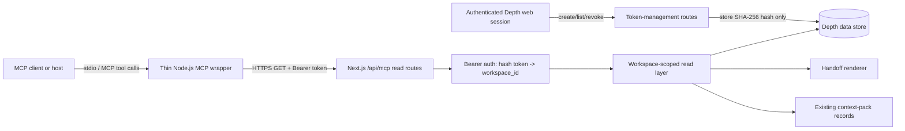

# Architecture overview

## Scope

This document describes the implementation at source commit `364f3e02d8b944a0439e9be3ab191259b3385b9e`. It is an as-of record, not a statement about later Depth architecture or current service status.

## Component boundary

## Thin MCP adapter responsibilities

`mcp/depth-mcp-server.mjs` contains:

- an MCP `Server` using stdio transport;
- five tool schemas;
- mapping from tool names and arguments to HTTP GET routes;
- propagation of one bearer token from `DEPTH_MCP_TOKEN`;
- JSON response formatting as MCP text content;
- propagation of non-2xx HTTP errors as thrown errors.

It does not contain a database client, user-session logic, token issuance, token hashing, workspace authorization, context-pack generation, handoff rendering, or source persistence.

## Underlying application responsibilities

### Token management

The web-session-authenticated token routes:

- generate `depth_mcp_` plus 24 random bytes encoded as hexadecimal;
- hash the token with SHA-256 before storage;
- return plaintext only in the creation response;
- list token metadata without plaintext or hash;
- revoke a token by deleting a token row constrained to the current workspace.

### Bearer authentication

`mcpAuth` parses `Authorization: Bearer ...` and calls `resolveMcpToken`. The token hash is looked up in `mcp_tokens`, yielding a `workspace_id`; successful use updates `last_used_at`.

In local mode, reads use the local server client. In Supabase mode, reads use a service-role client because the bearer token is not a Supabase user session. The application code, rather than RLS on the bearer request, is responsible for applying the workspace boundary.

### Workspace isolation

- Project routes first resolve the requested project and require `project.workspace_id === token.workspace_id`.
- Project lists filter directly by `workspace_id`.
- Full-source reads require `source.workspace_id === token.workspace_id`.
- Pack, handoff, and source-directory reads proceed only after the project passes the workspace check.

Unauthorized cross-workspace object lookups return a not-found response rather than the protected object.

### Context packs and handoffs

The MCP seam retrieves existing application state:

- `get_context_pack` fetches the latest existing context-pack row and maps claims to supporting source metadata.
- `get_handoff` invokes the application's handoff renderer using the existing pack, claims, sources, project name, and task context.

Neither operation is implemented in the wrapper, and `get_context_pack` does not create a new pack.

### Source discovery and expansion

`search_sources` performs server-side matching over title and body but returns only metadata. `get_source` is the separate, explicit expansion step that returns the full source body and metadata.

This reduces accidental bulk disclosure compared with returning source bodies during discovery, but it does not make full-source access low sensitivity: a valid workspace-scoped token can request a source body by ID.

## Deployment/runtime boundary

The wrapper was documented as a separately run example and was not part of the Next.js build. A real execution required:

1. a running Depth application;
2. an application-issued token;
3. the MCP SDK installed in the wrapper's Node.js environment; and
4. an MCP host configured to launch the stdio process.

The portfolio repository preserves the seam and supporting code but does not reproduce the complete application or a live deployment.
